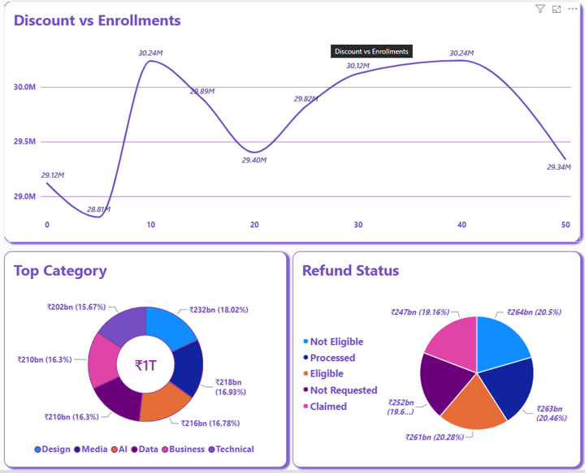
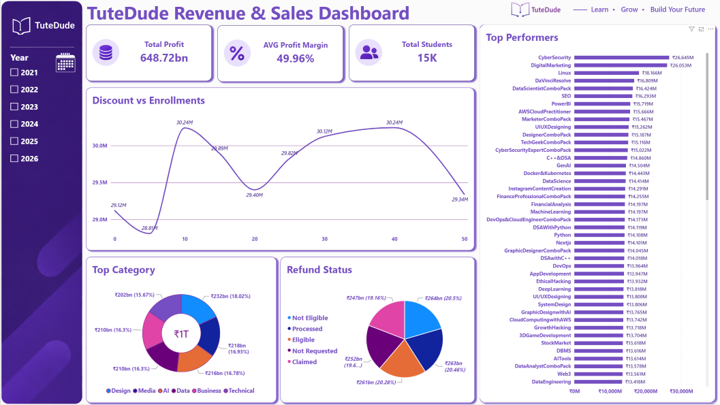

# TuteDude Revenue & Sales Dashboard 📊

## 🎯 Project Overview
This project involves cleaning a messy dataset ("TuteDude Massive Messy Dataset") and building an interactive Power BI dashboard. The dashboard acts as a business intelligence tool for the TuteDude management team to track revenue, course performance, the impact of discounts, and refund requests.

---

## ❓ Business Questions Answered
The dashboard is designed to answer the following key business questions:
1. **Total Revenue & Profit:** What is our Total Estimated Revenue and Profit margin?
2. **Top Performers:** Which 'Category' (e.g., Data, Media) and 'Course Name' generate the highest revenue?
3. **Discount Impact:** Does offering a 'Discount' actually increase student enrollments?
4. **Refunds:** What percentage of students requested a refund, and how does it impact the total revenue?

---

## 🛠️ Dashboard Design & Steps

### 1. Header & KPI Cards (Top Section)
To provide an at-a-glance view of the business health, the top section of the dashboard features 3 main KPI (Key Performance Indicator) Cards:
* **Total Profit:** Calculated using the `Total Profit` measure.
* **Total Students:** Calculated using the `Total Students` measure.
* **AVG Profit Margin:** Calculated using the Average of `Profit Margin (%)`.

### 2. Main Charts & Visualizations
The middle and lower sections of the dashboard contain specific visualizations to answer our business questions:

* **Top Performers (Bar Chart):** 
  * **Visual Type:** Clustered Bar Chart
  * **Axes:** Y-axis = `Course Name`, X-axis = `Total Revenue`
  * **Insights:** Highlights the best-selling courses. Conditional formatting is applied (Dark Purple for the top course, fading to lighter purple for the rest).

* **Top Category (Donut Chart):**
  * **Visual Type:** Donut Chart
  * **Axes:** Legend = `Category`, Values = `Total Revenue`
  * **Insights:** Shows the revenue distribution across different course categories (e.g., Data, Media, Tech).

* **Refund Status (Pie Chart):**
  * **Visual Type:** Pie Chart
  * **Axes:** Legend = `Refund Status`, Values = `Total Revenue`
  * **Insights:** Displays the percentage of revenue impacted by refunds vs. the revenue where refunds were "Not Requested". 

* **Discount vs Enrollments (Line Chart):**
  * **Visual Type:** Line Chart
  * **Axes:** X-axis = `discount`, Y-axis = `Total Students`
  * **Insights:** Tracks the trend of enrollments against the discount percentage offered to analyze if higher discounts drive more traffic.

### 3. Professional UI/UX Formatting
To give the dashboard a premium, corporate look, the following design principles were applied:
* **Color Theme:** A clean White/Light Gray background to make the Purple brand colors pop.
* **Clean Data Labels:** Data labels are turned ON for direct readability, and chart gridlines are turned OFF for a cleaner look.
* **Breathing Space:** Proper padding and alignment between cards and charts to avoid a cluttered UI.

---

## 🚀 Final Dashboard View
Below is the complete view of the final TuteDude Revenue & Sales Dashboard:

---
**Tools Used:** Power BI, Power Query (for Data Cleaning), DAX

# SECOND DASHBOARD - AUDIENCE & MARKETIN

## 📈 Audience & Marketing Analytics Dashboard

### ❓ Business Questions Answered
This section focuses on understanding our student demographics and evaluating the performance of our marketing strategies. It answers:
1. **Best Marketing Channel:** Which acquisition source brings in the highest revenue?
2. **Top States:** Which states have the highest reach and student density?
3. **Device Usage:** Do students prefer Mobile, Desktop, Laptop, or Tablet for their courses?
4. **Target Age Group:** What is the average age of our enrolled students and how are they distributed?

---

### 🛠️ Dashboard Design & Features

#### 1. Top KPI Cards (Audience Overview)
The top section highlights 5 crucial metrics to instantly understand our audience size and marketing efforts:
- **Average Student Age:** Average age of the students (currently 27.43).
- **Total Enrolled Students:** Total number of enrollments.
- **Total States Reached:** Distinct count of states where TuteDude has reach.
- **Avg Discount Given:** The average percentage of discount offered to students.
- **T. Marketing Channels:** Total number of distinct acquisition sources used.

#### 2. Demographics & Marketing Charts
The visualizations track both audience behavior and marketing profitability using 5 key charts:

- **Marketing Trend Over Time (Area Chart):** Tracks the growth of enrollments over time (from 2021 to 2026) to identify enrollment spikes.
- **Target Age Group Distribution (Column Chart):** Displays student distribution across different age groups, showing which specific ages bring the most students.
- **Device Usage (Donut Chart):** Breaks down the primary devices used by students (Desktop, Tablet, Laptop, Mobile).
- **Revenue by Marketing Channel (Column Chart):** Highlights which 'Acquisition Source' brings the highest revenue.
- **Top State (Bar Chart):** Ranks the top states based on total student enrollments.

---

### 🚀 Final Audience Dashboard View
Below is the complete view of the "Audience & Marketing Analytics" page:

